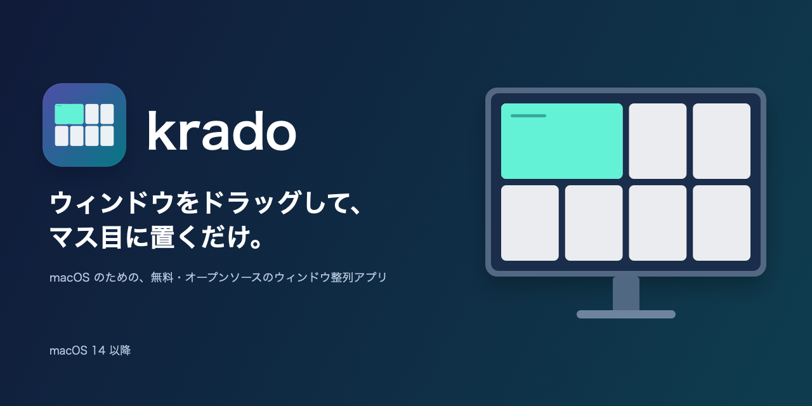
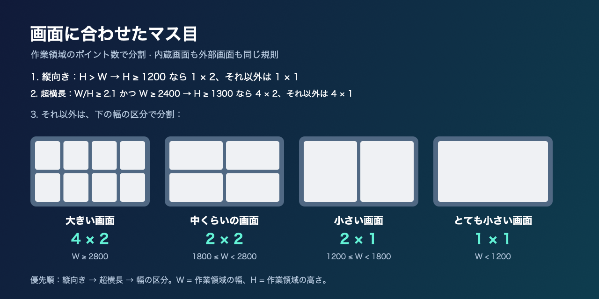

# krado
[English](README.md) | 日本語

[変更履歴](CHANGELOG.ja.md)

**ウインドウをドラッグして、マス目に配置。** macOS のメニューバーで動く、無料・オープンソースのウインドウ整列アプリです。

kradoはエスペラント語でマス目の意味です。読み方は「クラード」（KRAH-doh）です。

## 特徴

- いつもどおりウインドウをドラッグ。動き始めるとマス目が現れ、離すと配置できます。
- 内部の境界付近なら隣接する2マス、交点なら4マスをまとめて使えます。
- 画面サイズに合わせて自動で分割。縦置き・ウルトラワイドにも対応します。
- 複数画面、Retina のピクセル位置、Dock とメニューバーを除いた作業領域に対応します。
- 状態がわかるメニューバー、アクセシビリティの設定ガイド、ログイン時起動を備えています。
- 表示言語は macOS の言語設定に従います（日本語に対応）。
- アカウント不要。ウインドウの配置は端末内で処理し、MIT ライセンスで公開しています。

## 仕組みとレイアウト

krado はマウスのドラッグを観測し、macOS のアクセシビリティ機能でウインドウの位置とサイズを確認します。移動を検出すると、**カーソルがある画面**にマス目を表示します。強調された範囲で離すと、その範囲にウインドウを移動・リサイズします。修飾キーは不要です。

分割は、物理ピクセル数ではなく、**画面の作業領域のポイント数**で決まります。幅を `W`、高さを `H` とし、次の規則を上から順に適用します。内蔵画面と外部画面で規則は同じです。

| 作業領域（上から最初に一致した規則） | 列 × 行 | 例 |
| --- | --- | --- |
| 縦置き：`H > W` | `H ≥ 1200` なら **1 × 2**、それ以外は **1 × 1** | 高さがあれば上下半分、低い縦置き画面は分割なし |
| ウルトラワイド：`W/H ≥ 2.1` **かつ** `W ≥ 2400` | `H ≥ 1300` なら **4 × 2**、それ以外は **4 × 1** | 3440 × 1410pt → 4 × 2、2560 × 1050pt → 4 × 1 |
| 大型・4Kクラス：`W ≥ 2800` | **4 × 2** | 大型ディスプレイの **3008 × 1975pt → 8ゾーン**、3840 × 2135pt |
| 中型：`W ≥ 1800` | **2 × 2** | 1920 × 1055pt、2560 × 1415pt、16インチMBPの2056 × 1305pt、14インチMBPの1800 × 1137pt |
| 小型・MacBook Air 13クラス：`W ≥ 1200` | **2 × 1** | オーナーの内蔵画面 **1470 × 924pt → 2ゾーン**、1280 × 800pt、1710 × 1074pt、1512 × 950pt、1728 × 1085pt |
| それ以外 | **1 × 1**（分割なし） | 1024 × 740pt：作業領域全体を1ゾーンとして使用 |



一般的なアプリを収めるため、1ゾーンの大きさはおおむね **幅640pt以上・高さ約500pt以上**を目指しています。中型画面はオーナーの希望により2 × 2です。幅が約1200pt未満では半分でも狭くなるため、分割せず作業領域全体を1ゾーンにします。しきい値は目安であり、幅1200ptの画面では幅600ptずつになります。アプリ側の最小サイズ制約もあります。縦置きを最優先し、ウルトラワイドの規則も大型の幅の規則より先に適用するため、2800 × 1000ptは4 × 1です。

## 動作要件

- **macOS 14 以降**。
- 他のアプリのウインドウを読み取り・移動するためのアクセシビリティ権限。
- ソースからのビルドには **Swift 6 以降**と Apple の Command Line Tools。Xcode プロジェクトは不要です。アプリの更新機能に使う Sparkle は SwiftPM が取得します。

## インストール

**「アップデートを確認…」**は、Sparkle の更新用鍵で署名したリリースを提供できるようになった時点で有効になります。現在は無効です。

1. **公開後に [Releases](https://github.com/KazinaG/krado/releases) から `krado-x.y.z.dmg` をダウンロードします。** DMG を開き、**krado** を**「アプリケーション」**へドラッグしてください。ソースからビルドする場合は、リポジトリのフォルダで `scripts/build-app.sh` を実行すると `dist/krado.app` ができます。

   **krado.app** を **「アプリケーション」フォルダ**（`/Applications`）へドラッグしてください。**ログイン時に開く**機能には、アプリケーションフォルダ内への配置が必要です。個人用のアプリケーションフォルダ（`~/Applications`）でも使えます。インストールするコピーは1つにしてください。

2. **krado を開き、macOS のセキュリティ警告を解除します。** krado はまだ Apple Developer ID による署名・公証を行っていないため、「開発元が未確認」「検証できない」などの警告が出る場合があります。信頼できるコピーであることを確認してから進めてください。

   - **macOS 15 Sequoia 以降（macOS 26/27 を含む）：**
     1. 「アプリケーション」内の **krado** をダブルクリックします。警告が出たら **「完了」** をクリックしてください。ゴミ箱には入れないでください。
     2. **システム設定 → プライバシーとセキュリティ**を開き、下へスクロールして **「セキュリティ」** を表示します。
     3. **「krado がブロックされました…」** という内容のメッセージを探し、**「このまま開く」** をクリックします。
     4. パスワードまたは Touch ID で認証し、次のダイアログでもう一度 **「このまま開く」** をクリックします。

     このコピーに対する承認は一度だけで済みます。**macOS 15 以降では、Control キーを押しながらクリック →「開く」では、この警告を回避できません。**
   - **macOS 14 Sonoma：**「アプリケーション」内の **krado** を Control キーを押しながらクリック（右クリック）し、**「開く」→「開く」** を選びます。
   - **上級者向け（ターミナル）：** 信頼できるコピーを「アプリケーション」へ移動した後、代わりに次のコマンドで隔離属性を取り除くこともできます。

     ```sh
     xattr -dr com.apple.quarantine /Applications/krado.app
     ```

3. **ウインドウを配置するため、アクセシビリティを許可します。** krado は、他のアプリのウインドウがどこにあるかを確認し、マス目にドロップしたときに移動・サイズ変更するために、この権限を必要とします。

   **プライバシー：** krado は入力した文字を読み取らず、画面の内容を録画・閲覧せず、ウインドウの配置は端末内で処理します。更新機能の設定後は、更新情報や配布ファイルの取得のために GitHub へ接続します。ウインドウの移動を知るために、マウスのドラッグだけを監視します。「画面収録」の権限も要求しません。

   1. 初回起動時に krado が設定ガイドを表示します。**「システム設定を開く」** をクリックします。
   2. **システム設定 → プライバシーとセキュリティ → アクセシビリティ**で **krado** をオンにします。見当たらない場合は **「+」** から `/Applications/krado.app` を追加してください。
   3. krado が許可を自動で検出し、**「準備完了！」**（All set!）と表示してガイドを閉じます。これでウインドウをマス目にドラッグして配置できます。

   ガイドは krado のメニューにあるアクセシビリティの状態から開き直せます。

4. **更新・再ビルド後に再び許可を求められたら、古い許可の項目を入れ替えます。** macOS は、この権限をアプリの特定のビルドにひも付けます。krado は Developer ID 署名を行っていないため、新しいビルドはそれぞれ別のアプリとして扱われます。

   **システム設定 → プライバシーとセキュリティ → アクセシビリティ**で古い **krado** を選び、**「−」** で削除してください。その後、新しい **krado** をオンにします。見当たらない場合は **「+」** で `/Applications/krado.app` を追加します。ガイドの **「システム設定を開く」** をもう一度押して、この設定画面へ戻ることもできます。krado が新しい許可を自動で検出します。

## ログイン時に開く

条件を満たす初回起動時は、既定で **ログイン時に開く**を有効にします。メニューからいつでも切り替えられます。macOS の承認が必要な場合は、システム設定の **ログイン項目**へ進む項目を表示します。

`/Applications`・`~/Applications` 以外にある場合や、**AppTranslocation** のパスから実行されている場合は、自動登録しません。メニューに「アプリケーション」フォルダへの移動案内を表示します。アプリを移動し、必要なら隔離属性・起動制限を解消して、その場所から開き直してください。必要に応じてメニューで有効にできます。登録エラーはメニューに表示し、ウインドウ整列は引き続き使えます。

## 使い方

1. 通常のアプリのウインドウを、タイトルバーからドラッグします。
2. 使いたいマスへカーソルを移します。内部の境界付近では2マス、2 × 2・4 × 2の交点では4マスが強調されます。
3. 離すと配置します。作業領域の外で離すと配置しません。

- **Shift を押しながらドラッグ：** 通過したマス全体を囲む長方形に配置します。3〜4列や複数行にも広げられます。Shift を押した位置から選択が始まり、境界で強調された範囲も含みます。作業領域の外でも選択を保ち、別の画面へ移ると、その画面で選び直します。Shift を離すと通常の選択に戻ります。
- **Option を押しながらドラッグ：** マス目を隠し、配置を一時的に無効にします。ドロップ前に Option を離すと再開し、押したまま離すと配置しません。Option は Shift より優先され、累積した選択をリセットします。
- **Ctrl + Cmd + 矢印：** 操作中のウインドウを、選択範囲の大きさを保ったまま1マス移動します。マス目に揃っていない場合、最初の1回はウインドウの中心がある1マスに揃えます。画面端では、その方向に隣接する画面があれば、向かい側の端の最寄りの1マスへ移動します。
- **Ctrl + Cmd + Shift + 矢印：** 現在の画面内で、その方向へ1マス分広げます。揃っていない場合は、中心があるマスを起点に広げます。広げ始めたマスを覚えておき、反対向きの矢印を押すと、そのマスに向かって1回につき1マスずつ縮めます。広げ始めたマスより小さくはなりません。ウインドウを動かす（ドラッグや Ctrl + Cmd + 矢印）か、別のウインドウを操作すると、覚えたマスは忘れます。

Ctrl + Option は VoiceOver の修飾キーなので使用しません。krado の実行中は、Ctrl + Cmd + 矢印が Xcode の一部の移動ショートカットと競合します。

境界の判定幅は24pt（両側12pt）です。外周ではマスを結合しません。1行のレイアウトには水平方向の内部境界がありません。1 × 1ではゾーン内のどこで離しても作業領域全体に配置します。マス間の隙間は0です。リサイズを検出したドラッグは配置対象から外します。krado 起動前から開いていたウインドウも使えます。

必要なら **画面構成を再読込**を使ってください。画面構成の変化は自動でも検出します。メニューには **krado について**、GitHub へのリンク、**krado を終了**もあります。

## 困ったとき

- **許可済みなのに配置されない：** メニューの監視状態とアクセシビリティ設定を確認し、インストール先から krado を開き直してください。画面の寸法が古い場合は画面構成を再読込します。
- **更新・再ビルド後に再び許可を求められる：** [インストール](#インストール)の手順4に従い、古いアクセシビリティの項目を入れ替えてください。
- **ログイン時に開けない：** `/Applications` または `~/Applications` へ移動して開き直し、**システム設定 → 一般 → ログイン項目**で承認待ちがないか確認してください。転送配置・隔離されたコピーは、先に上記のインストール手順が必要な場合があります。
- **ウインドウが収まらない：** アプリの最小サイズ制約や、アクセシビリティ経由で位置・サイズを変更できない場合があります。macOS 標準のタイリング、フルスクリーン、保護されたウインドウにも制約があります。krado は非対応のウインドウを対象外にし、アプリの制約を強制的に回避しません。

位置とサイズの変化から移動を推定するため、タイトルバー以外から始めたドラッグでもウインドウが動けば検出する場合があります。権限、Spaces・フルスクリーン、フォーカス、アプリごとの挙動には実機での手動確認が必要です。純粋ロジックのテストだけでこれらを確認したとは扱いません。[設計と手動確認項目](docs/design.md)を参照してください。

## 今後の予定

- Esc によるドラッグ配置のキャンセル。
- 画面ごとに変更できるレイアウト。
- キーボードショートカット。
- Homebrew cask。
- Developer ID 署名・公証済みビルド。
- 将来の App Store 配布。

## フィードバックと貢献

krado は [MIT ライセンス](LICENSE)で公開している、無料・オープンソースのアプリです。外部からのプルリクエストやコードの貢献は受け付けていません。フィードバック・質問・不具合報告は [GitHub Issues](https://github.com/KazinaG/krado/issues) で歓迎します。方針は [CONTRIBUTING.md](CONTRIBUTING.md) を参照してください。

MIT ライセンスのもとで、自分用にフォーク・改変できます。自分のコピーをソースからビルド・テストする場合：

```sh
swift test
scripts/build-app.sh
```

## ライセンス

[MIT](LICENSE) © 2026 Kazina.
