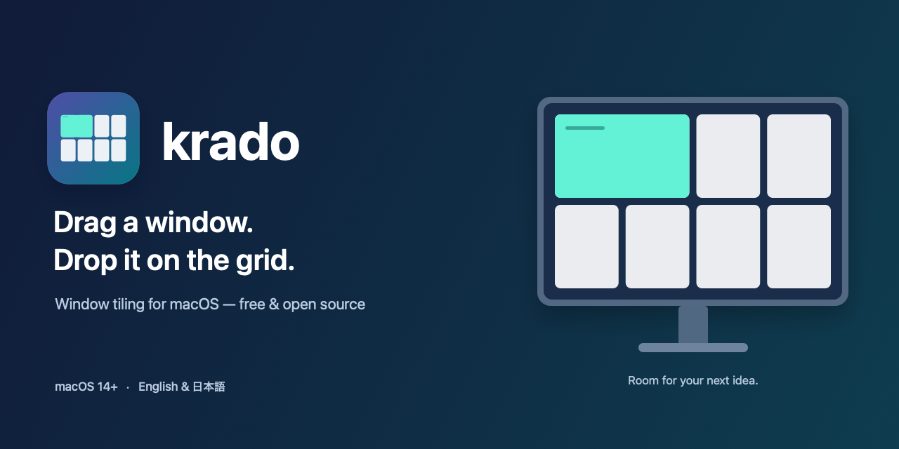
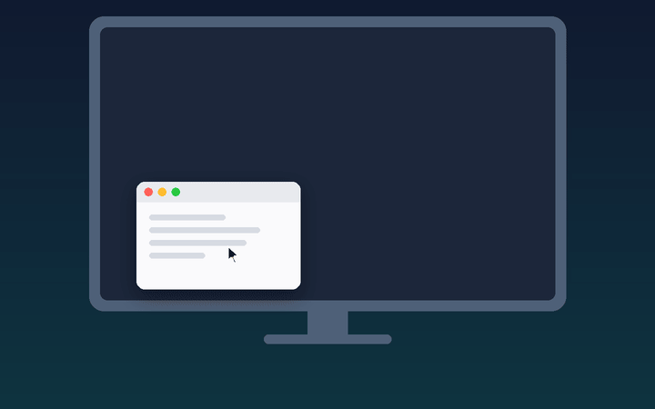
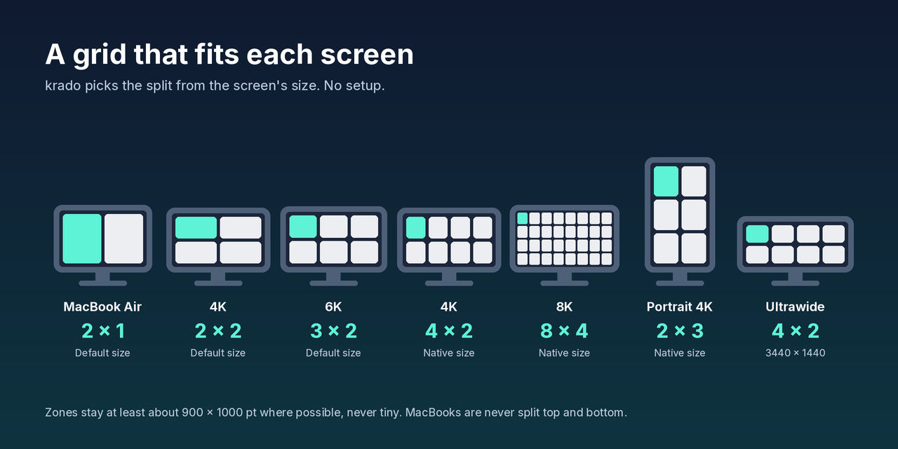
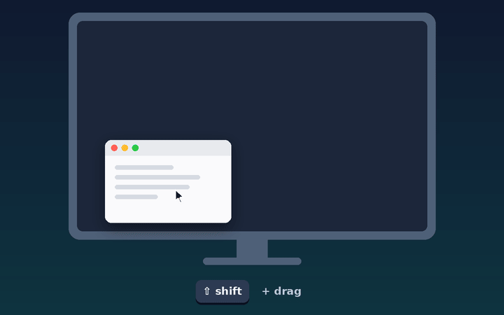
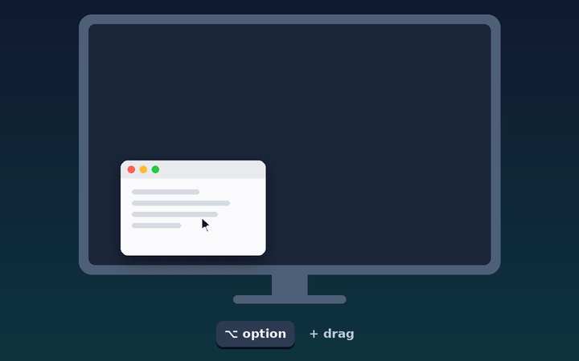
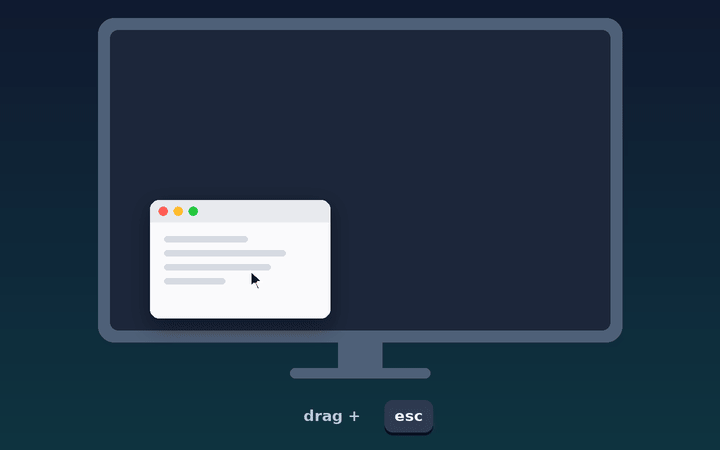
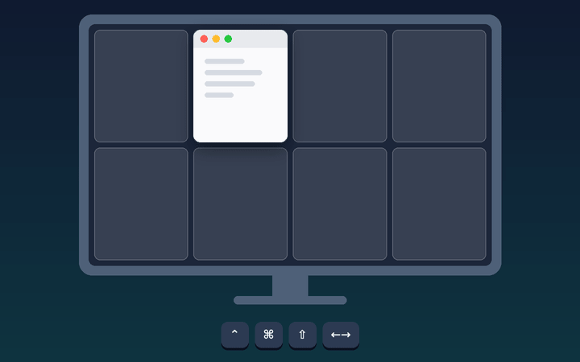

# krado

English | [日本語](README.ja.md) · [Changelog](CHANGELOG.md)

**Drag a window. Drop it on the grid.** krado is a small menu-bar app that tiles windows on macOS. There is nothing to set up: it picks a grid that fits each screen, from a MacBook to large and portrait monitors.

Free and open source (MIT License).

## A grid that fits each screen

Inspired by Microsoft PowerToys FancyZones, krado builds the grid for you, and never makes zones too small for the screen. A typical 4K display tops out at 4 columns, and a MacBook Air's built-in screen is never split top and bottom, because each half would be too short to work in.

krado chooses the split from the screen's size, as set in **System Settings → Displays**. Every screen, built-in or external, follows the same rules.

| Screen | Grid | For example |
| --- | --- | --- |
| MacBook | **2 × 1** | MacBook Air / Pro screens at their default size |
| Typical monitor | **2 × 2** | 1920 × 1080, 2560 × 1440, or a 4K/5K display at its default size |
| Large | **3 × 2** to **8 × 4** | High-resolution displays at native size: 4K → 4 × 2, 6K → 6 × 3, 8K → 8 × 4 |
| Very small | **1 × 1** | Narrow or low-resolution screens |
| Portrait | **1 × 2** or more | A monitor turned vertical (short portrait screens stay 1 × 1) |
| Ultrawide | **4 × 1** or more | Very wide monitors, with two rows when tall enough |

## Use it

Drag any window by its title bar. A grid appears on the screen under the pointer; release to drop the window into the highlighted zone. Near a line between zones, the highlight covers both sides.

| How | See it |
| --- | --- |
| **Shift + drag** — sweep across zones to cover all of them. |  |
| **Hold Option while dragging** — the grid hides while Option is held and comes back when you let go of Option, so you can decide at any moment. |  |
| **Press Esc once while dragging** — the grid is gone for the rest of this drag, even after you let go of the key. Handy when you change your mind halfway. |  |
| **Keyboard** — **⌃⌘ + arrow** moves the active window one zone (and onto the next screen at the edge). **⌃⌘⇧ + arrow** grows it; the opposite arrow shrinks it back. |  |

The menu-bar icon shows whether krado is working. Its menu has **Launch at Login** (off until you turn it on; the welcome window offers it as one click) and **Check for Updates…**. krado checks for updates automatically and always asks before installing one.

## Install

Requires macOS 14 or later.

1. Download `krado-x.y.z.dmg` from [Releases](https://github.com/KazinaG/krado/releases), open it, and drag **krado** to **Applications**.
2. Open krado. If macOS says it cannot verify the app:
   - **macOS 15 or later:** click **Done**, then go to **System Settings → Privacy & Security** and click **Open Anyway**.
   - **macOS 14:** Control-click krado in Applications and choose **Open**.
3. Allow **Accessibility** when krado asks. It needs this to move and resize other apps' windows. krado detects the permission automatically.

Releases are signed with the same certificate every time, so updates keep the Accessibility permission. If macOS still asks again, remove the old **krado** entry in **System Settings → Privacy & Security → Accessibility** and turn on the new one.

## Uninstall

Choose **Uninstall krado…** in krado's menu. It turns off Launch at Login, removes krado's Accessibility permission, settings and caches, moves the app to the Trash, and quits.

If that is not possible (for example when krado runs from the disk image), remove **krado** in **System Settings → General → Login Items & Extensions** and in **Privacy & Security → Accessibility** (select it and click **−**), then move krado to the Trash.

## Privacy

krado only watches mouse drags, the Esc key while you drag, and its own shortcuts, and moves windows through Accessibility. It does not read what you type or look at your screen. Nothing leaves your Mac except update checks, which fetch the update feed from GitHub.

## Troubleshooting

- **No grid appears when dragging:** check the status in krado's menu and that krado is on in **Accessibility**, then quit and reopen it.
- **A window won't fit:** some apps limit their window size or position; krado leaves those as they are.

## Feedback

Questions and bug reports are welcome in [GitHub Issues](https://github.com/KazinaG/krado/issues). Pull requests are not accepted; see [CONTRIBUTING.md](CONTRIBUTING.md).

To build it yourself: `swift test`, then `scripts/build-app.sh` (Swift 6 or later).

## License

[MIT](LICENSE) © 2026 Kazina.
